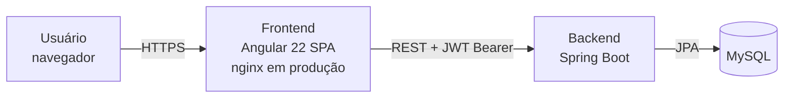
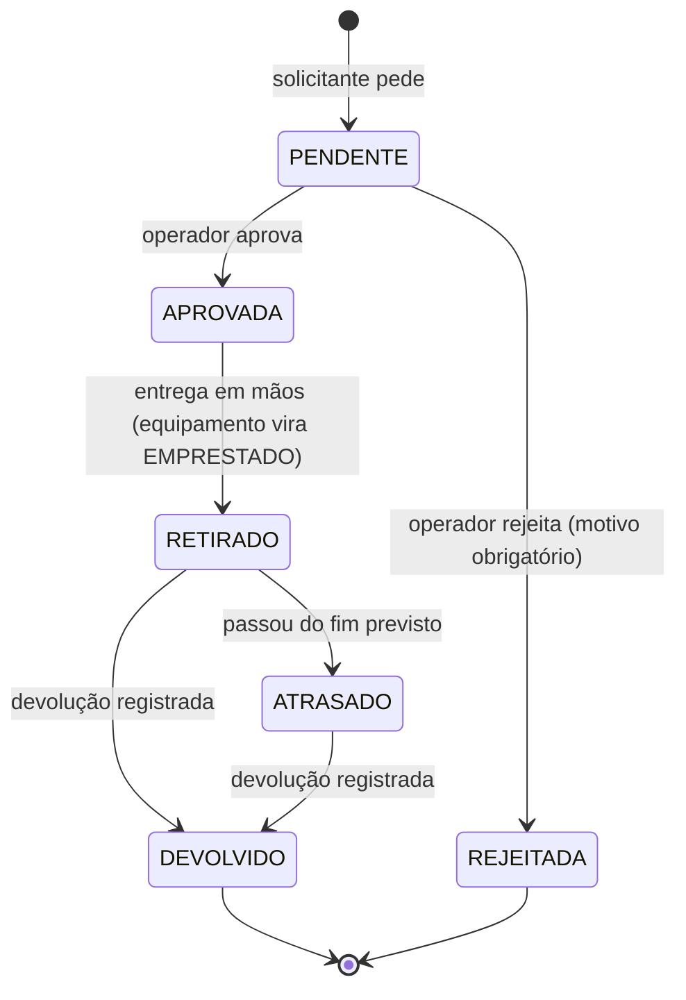

# Arquitetura

## Visão geral

| Camada | Repositório | Tecnologia | Responsabilidade |
|---|---|---|---|
| Frontend | `EquipTrak/frontend` | Angular 22, Tailwind 4, Vitest | Telas, validação de formulários, sessão do usuário e navegação |
| Backend | `EquipTrak/backend` | Spring Boot (Java) | Regras de negócio, autenticação JWT e API REST |
| Banco | — | MySQL (via `compose.yaml` do backend) | Persistência de usuários, equipamentos, solicitações e histórico |

> O repositório `EquipTrak/backend` ainda tem só o commit inicial. A autenticação foi desenvolvida no módulo `backend-auth`, de onde vem o contrato descrito em [api.md](api.md). Os demais endpoints e o modelo de [banco-de-dados.md](banco-de-dados.md) são a **proposta do frontend**: a equipe do backend deve validá-los.

## Ciclo de vida de um empréstimo

Na devolução, a condição informada define a situação do equipamento: **Com avaria** o deixa INDISPONÍVEL, **Ótima** ou **Boa** o deixam DISPONÍVEL. Um solicitante com empréstimo ATRASADO fica bloqueado para novos pedidos.

## Frontend por dentro

- **Componentes standalone** e **lazy loading por rota**. O bundle inicial tem cerca de 80 KB comprimidos, e o painel carrega sob demanda.
- **Estado com signals.** O `AuthService` guarda a sessão e o `EquipTrackService` guarda o estado do painel. Não há biblioteca de estado externa.
- **Segurança**:
  - `authGuard` protege as rotas privadas, e `guestGuard` impede o usuário logado de voltar ao login.
  - O interceptor anexa o token Bearer só nas chamadas ao `API_URL`. Em um 401, ele limpa a sessão.
  - O `returnUrl` só aceita caminhos internos, o que evita redirecionamento aberto.
- **Produção**: build com hash nos arquivos, servido por nginx com gzip, cache de 1 ano nos arquivos estáticos, `index.html` sem cache e fallback de rotas para o SPA (`nginx.conf`).

## Ambientes

| Ambiente | Comando | URL |
|---|---|---|
| Desenvolvimento local | `npm start` | http://localhost:4200 |
| Desenvolvimento em Docker | `docker compose up --build` | http://localhost:4200 |
| Produção local (nginx) | `docker compose --profile prod up --build` | http://localhost:8081 |
| Backend | repositório do backend | http://localhost:8080 |
