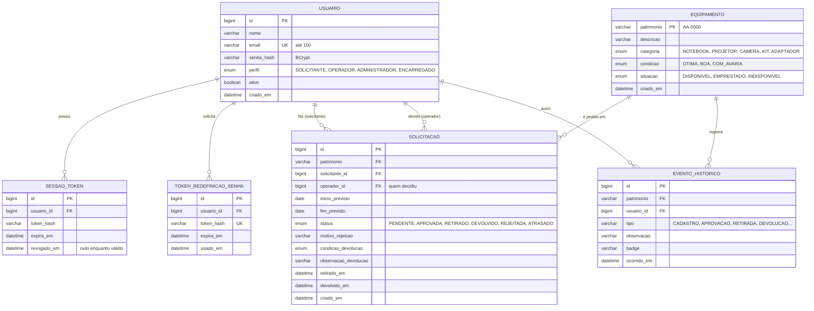

# Banco de dados

Banco **MySQL**, acessado pelo backend via JPA. Em desenvolvimento, ele sobe pelo `compose.yaml` do backend.

> **Status:**
> - As tabelas `usuario` e `sessao_token` vêm do módulo de autenticação (`backend-auth`).
> - As demais tabelas são o **modelo proposto** a partir das telas e regras do frontend. A equipe do backend deve validá-las e criá-las nas migrations.

## Diagrama

## Regras e índices recomendados

- **`equipamento.patrimonio`** é a chave natural: único, no formato `^[A-Z]{2}-\d{4}$`.
- **Um equipamento EMPRESTADO não pode ter uma segunda retirada.** O backend deve validar isso na transição APROVADA → RETIRADO.
- **Índices**:
  - `solicitacao (status)`, para a fila do operador;
  - `solicitacao (solicitante_id, status)`, para "minhas solicitações" e o bloqueio por atraso;
  - `evento_historico (patrimonio, ocorrido_em DESC)`, para o histórico.
- **ATRASADO** pode ser gravado por um job diário ou calculado na consulta (`status = RETIRADO AND fim_previsto < hoje`).
- **Limpeza de tokens**: os registros vencidos de `sessao_token` e `token_redefinicao_senha` devem ser apagados periodicamente. Essa pendência já aparece na documentação do backend.
- **Senhas**: só o hash BCrypt é guardado, e o limite de 72 caracteres vem do próprio BCrypt.
